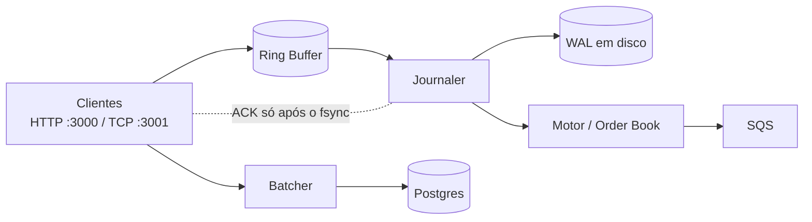

# Goruptor

Motor de matching de ordens (uma "corretora" em miniatura) escrito em Go, inspirado na arquitetura **LMAX Disruptor**:
ring buffer lock-free, um único consumidor de negócio, journal em disco e prioridade preço-tempo.

> **Status: projeto de estudo / laboratório.** O núcleo (ring buffer, WAL, order book) é sólido e bem testado,
> mas faltam peças para operar de verdade (validação, autenticação, cancelamento de ordens...). Veja
> [Limitações conhecidas](#limitações-conhecidas).

## O que ele faz

- Recebe ordens de compra/venda por **HTTP** (JSON) ou por **TCP binário** (frames de 25 bytes).
- Só **confirma** uma ordem (ACK) depois de ela estar gravada em disco (WAL com `fsync` em lote).
- Casa as ordens num order book em memória (melhor preço primeiro, FIFO dentro do mesmo preço).
- Se o processo cair, **reproduz o WAL** e reconstrói exatamente o mesmo livro.
- Publica trades no SQS, arquiva ordens no Postgres e mostra livro + candles num dashboard web.



Detalhes e garantias: [docs/ARCHITECTURE.md](docs/ARCHITECTURE.md). Desempenho: [docs/PERFORMANCE.md](docs/PERFORMANCE.md).

## Como rodar

**Pré-requisitos:** Go (versão do `go.mod`), Docker com `docker-compose` e Terraform.

```bash
make setup   # sobe o MiniStack (AWS local) e provisiona SQS + RDS com Terraform
make run     # inicia o servidor (rode da raiz do repositório)
```

Abra <http://localhost:3000> para ver o livro de ofertas e os candles. Enviando uma ordem:

```bash
curl -X POST localhost:3000/api/orders \
  -H 'Content-Type: application/json' \
  -d '{"order_id": 1, "price": 65000, "quantity": 2, "side": "SELL"}'
# 202 {"message":"Ordem confirmada e enviada para o motor","order_id":1}
```

`make` (sem argumentos) lista todos os atalhos.

### Portas e endpoints

| Porta / rota | Descrição |
|---|---|
| `:3000` `GET /` | Dashboard (`web/index.html`) |
| `:3000` `POST /api/orders` | Envia uma ordem. `202` = confirmada em disco; `400` = ordem inválida; `409` = `order_id` já usado; `503` = **não** confirmada |
| `:3000` `GET /api/candles` | Candles de 1 min das últimas 6 h (devolvidos no header `HX-Trigger`, usado pelo HTMX) |
| `:3000` `GET /ws` | WebSocket: snapshot do livro (10 níveis por lado) a cada 200 ms |
| `:3000` `/debug/pprof/` | Profiling do Go |
| `:3001` | TCP binário (protocolo abaixo) |

### Protocolo TCP binário

Cada ordem é um frame de **25 bytes**, big-endian:

| Bytes | Campo | Tipo |
|---|---|---|
| `0..8` | `OrderID` | `uint64` |
| `8..16` | `Price` | `uint64` |
| `16..24` | `Quantity` | `uint64` |
| `24` | `Side` | `uint8` (`0` = BUY, `1` = SELL) |

O servidor responde **1 byte por ordem**:

| Resposta | Significado | A conexão |
|---|---|---|
| `1` | Confirmada: já está no WAL em disco | continua |
| `2` | Inválida (`order_id`, `side`, `price` ou `quantity` fora das regras) | continua |
| `3` | `order_id` já utilizado | continua |
| `0` | **Não** confirmada (servidor desligando ou disco com falha) | é encerrada |

Pode-se enviar vários frames em pipeline: o servidor confirma em lote, com **um `fsync` por lote de frames lidos**, não por frame. Exemplo de cliente: [`cmd/dma-loadtest`](cmd/dma-loadtest/main.go).

### Regras de validação

| Campo | Regra |
|---|---|
| `order_id` | maior que 0 e **único**: repetir um ID é recusado (HTTP `409`, TCP `3`), inclusive depois de um reinício |
| `side` | `BUY` ou `SELL` (HTTP, sem diferenciar maiúsculas); `0` ou `1` (TCP) |
| `price` | de 1 a 10¹⁵ |
| `quantity` | de 1 a 10⁹ (impede que a soma de um nível de preço estoure `uint64`) |

### Desligamento

`SIGINT`/`SIGTERM` (Ctrl+C, `docker stop`) disparam um desligamento ordenado, com limite de 15 s:
para de aceitar conexões, termina as ordens em andamento, drena o anel (journaler e motor), fecha o WAL,
grava o último lote no Postgres e esvazia os trades do SQS. **Toda ordem que recebeu ACK é preservada.**
Um frame que o servidor ainda não tinha lido não recebe ACK; o cliente sabe que ele não foi aceito.

### Durabilidade

A variável `GORUPTOR_WAL_SYNC` escolhe o equilíbrio entre segurança e velocidade:

| Valor | Comportamento |
|---|---|
| `always` (padrão) | `fsync` a cada lote; ACK só depois da ordem em disco. Sobrevive a queda de energia. |
| `200ms`, `1s`... | `fsync` no máximo a cada intervalo; ACK após o `write` no SO. Mais rápido; queda de energia pode perder até o intervalo. |

## Testes e benchmarks

```bash
make test       # todos os testes, com o race detector
make bench      # benchmarks (anel, motor, WAL, TCP ponta a ponta); veja docs/PERFORMANCE.md
make loadtest   # carga no TCP (com o servidor rodando): ordens confirmadas/s
make check      # o mesmo que a CI: gofmt + vet + testes
make ab         # compara versões (ex.: REFS="main perf/bottlenecks") sob a mesma carga, alternadas, sem nuke/setup
```

Alguns testes que valem a leitura:

- **Replay determinístico**: 8 produtores concorrentes, WAL real; um livro novo reproduzindo o WAL fica idêntico ao vivo, com os mesmos trades.
- **Crash em cada byte**: trunca o WAL em todas as posições possíveis e exige recuperação íntegra (o formato binário tem CRC por registro).
- **Migração do WAL antigo (JSON)**: convertido na primeira abertura, com o original preservado ao lado e tolerância a queda no meio da migração.
- **ACK implica em disco**: um leitor independente lê o arquivo durante a carga e confirma que nenhum ACK saiu adiantado.
- **Falha de disco e shutdown sob carga**: ninguém trava e nenhuma ordem aceita se perde.

Ordem de grandeza medida num container de 2 vCPUs (no seu hardware os números mudam):

| Medida | Resultado |
|---|---|
| Matching + handler, 1 núcleo | ~265 ns por ordem (~3,8 M ordens/s) |
| Pipeline ponta a ponta (anel + motor), sem disco | ~2 a 3 M ordens/s |
| TCP ponta a ponta, em pipeline, ACK após `fsync` | ~490 mil ordens/s (depende muito do disco) |
| Anel com 128 produtores concorrentes | ~200 ns por ordem |

Análise de gargalos, antes/depois e como reproduzir: [docs/PERFORMANCE.md](docs/PERFORMANCE.md).

## Estrutura do projeto

```
cmd/
  goruptor-server/   servidor (HTTP + TCP + motor)
  dma-loadtest/      cliente de carga do TCP binário
internal/
  disruptor/         ring buffer lock-free + estágio de journal (group commit)
  matching/          order book, heaps de preço e handler do motor
  storage/           WAL binário (registros de 41 bytes com CRC32C) e batcher do Postgres
  api/               HTTP (Fiber), TCP binário e candles
  cloud/             publicador SQS
infra/               Terraform do ambiente local (SQS + RDS no MiniStack)
web/                 dashboard (HTMX + lightweight-charts)
docs/                documentação de arquitetura
```

## Limitações conhecidas

O que ainda falta (ordenado por impacto):

- **O conjunto de `order_id`s cresce sem limite** (~50 MB por milhão de ordens, em memória). Para produção, troque por uma janela de tempo ou um filtro de Bloom.
- **`trade_history` guarda ordens, não trades**: os candles são calculados com o preço das ordens enviadas, não com o preço de execução.
- `AccountID`, `AssetID`, `BuyerID` e `SellerID` existem nas structs mas nunca são preenchidos; só há um ativo.
- Sem cancelamento/modificação de ordens e sem ordens a mercado.
- O WAL nunca é truncado e não há snapshot: o boot reprocessa o histórico inteiro (hoje ~11 milhões de eventos/s no formato binário).
- Credenciais e endpoints fixos no código, `pprof` e API sem autenticação (aceitável só em ambiente local).

## Licença

Ainda não definida.
