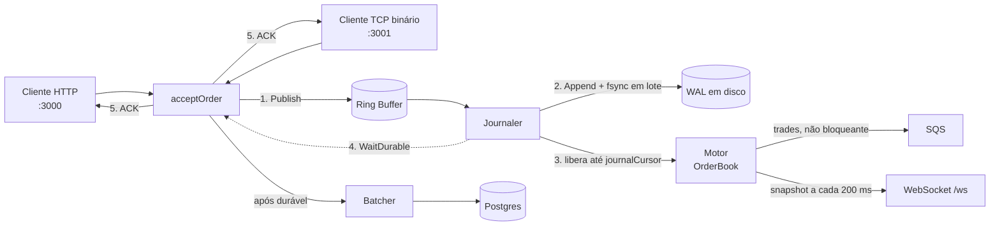

# Arquitetura

Este documento explica **por que** o Goruptor é montado assim e quais garantias cada peça dá.
Para rodar o projeto, veja o [README](../README.md).

## Visão geral

Uma ordem passa por seis passos (`internal/ingest`, usado por HTTP e TCP):

0. **Validação e deduplicação**: regras de campo e `order_id` único (`IDSet`). Ordem inválida ou repetida é recusada antes de tocar no anel.
1. **Publish**: reserva uma sequência no anel, sem lock (`atomic.Add`).
2. **Journal**: um estágio dedicado lê o anel **em ordem de sequência**, grava em lote no WAL e faz um `fsync` por lote.
3. **Motor**: só processa eventos cuja sequência já está no journal.
4. **WaitDurable**: o produtor espera o journaler confirmar a sequência dele.
5. **ACK**: só agora o cliente recebe a confirmação. Só então a ordem vai para o Postgres.

## Invariantes

| # | Invariante | Como é garantido | Teste |
|---|---|---|---|
| 1 | A ordem do WAL é a ordem do motor | Só o journaler escreve o WAL, lendo o anel por sequência | `TestJournal_WALOrderEqualsEngineOrder` |
| 2 | Replay do WAL reproduz o livro em memória | Consequência do 1 | `TestRecovery_ConcurrentProducersReplayReproducesLiveBook` |
| 3 | ACK ⇒ ordem em disco | `WaitDurable` só retorna após o `fsync` | `TestJournal_AckImpliesDurable`, `TestRecovery_AckedOrdersAreAlwaysInTheFile` |
| 4 | O motor nunca passa do journal | O consumidor é limitado por `journalCursor`, não por `producerCursor` | `TestJournal_EngineNeverAheadOfJournal` |
| 5 | Falha de disco para tudo, sem travar ninguém | Fail-stop: todos os spins checam `failedFlag` | `TestJournal_FailureIsFailStopAndNeverHangs` |
| 6 | Ordem aceita no shutdown nunca se perde | `Close` fecha a reserva atomicamente | `TestShutdown_EveryAcceptedOrderIsJournaledAndProcessed` |
| 7 | Nenhuma ordem confirmada se perde num desligamento sob carga | Sequência ordenada de `app.Components.Shutdown` | `TestGracefulShutdown_UnderLoad_NothingConfirmedIsLost` |
| 8 | Um `order_id` é executado no máximo uma vez, mesmo com reenvios concorrentes e reinícios | `IDSet` sharded, semeado com o WAL no boot | `TestDuplicateStorm_EachOrderIDExecutesExactlyOnce`, `TestRestart_ReplayedIDsStillRejectedAsDuplicates` |
| 9 | Ordem inválida nunca chega ao anel nem ao WAL | `ingest.Validate` antes de tudo | `TestSubmit_InvalidNeverTouchesEngineOrIDs` |

Antes do journaler, cada goroutine fazia `wal.Log` e depois `Publish`. A ordem do arquivo era decidida por uma
corrida diferente da que decidia a ordem do motor, então os invariantes 1 e 2 não valiam, e o ACK saía antes do disco.

## Ring buffer (`internal/disruptor`)

Inspirado no LMAX Disruptor, com vários produtores e um único consumidor de negócio.

- **Cursores** em linhas de cache separadas (padding) para evitar *false sharing*:
  `claimCursor` (reserva), `producerCursor` (escrita concluída), `journalCursor` (já no WAL), `consumerCursor` (motor).
- **Reserva**: `seq = claimCursor.Add(1) - 1`. Cada produtor escreve no próprio slot em paralelo; depois publica
  em ordem com um CAS em `producerCursor`.
- **Backpressure**: se `seq - consumerCursor >= capacidade`, o produtor cede a CPU (`Gosched`).
- **Fechamento sem corrida**: `Close` soma um bit alto (`closedBit`) ao `claimCursor`. O valor anterior é exatamente
  o número de sequências legítimas; quem reservar depois vê o bit e recebe `ErrClosed`. Não há custo extra no caminho quente.
- **Fail-stop**: se o journal falhar, `failedFlag` é ligado, os `WaitDurable` acordam com `ErrJournalFailed`, o motor
  processa só o que já estava em disco e para.

### Group commit

O journaler pega **tudo que está disponível** (até `MaxBatch`, padrão 4096), faz um `Append` e um `fsync`, e
só então avança o `journalCursor` e acorda quem espera. Com muitas conexões concorrentes, o custo de um `fsync` é dividido
entre elas; no benchmark `BenchmarkPipeline_DurableAck` saem ~30 ordens por `fsync`.

### Política de durabilidade

`GORUPTOR_WAL_SYNC` (lida em `cmd/goruptor-server/main.go`):

| Valor | ACK sai depois de | Sobrevive a |
|---|---|---|
| `always` (padrão) | `fsync` do lote | crash do processo **e** queda de energia |
| duração (`200ms`, `1s`) | `write` no SO; `fsync` no máximo a cada intervalo | crash do processo; queda de energia pode perder até o intervalo |

## WAL (`internal/storage/wal.go`)

- Formato **JSON Lines**: um evento por linha, na ordem de sequência.
- É o `disruptor.Journal` do anel: `Append` (entrega ao SO) e `Sync` (`fsync`). Sem goroutine nem canal próprios.
- **Reparo de cauda**: ao abrir, se o processo caiu no meio de uma linha, o lixo depois do último evento íntegro
  é removido e o arquivo termina em `\n`. Sem isso, os próximos appends ficariam colados no lixo.
  Testado truncando o arquivo em **cada byte** (`TestWAL_CrashAtEveryByte`).
- **Recuperação**: no start, `ReadAll` reprocessa o arquivo no livro (modo restauração: não reenvia trades ao SQS).

## Motor (`internal/matching`)

- Livro com um `map[preço]*PriceLevel` por lado, um heap de preços (melhor bid/ask em O(1)) e fila FIFO por nível
  (prioridade preço-tempo). Preço e quantidade são `uint64` (inteiros, sem ponto flutuante).
- O motor roda em **uma única goroutine**; por isso o hot path não pode fazer I/O (veja o comentário em `handler.go`).
- Trades saem para o SQS por canal **não bloqueante**: se a fila encher, o trade é descartado em vez de travar o motor.

## Entrada de ordens (`internal/ingest`)

`Ingress.Submit` é a única porta de entrada. Os erros se separam por quem errou:

| Erro | Quem errou | HTTP | TCP |
|---|---|---|---|
| `ErrInvalidOrder` | cliente | 400 | `2` |
| `ErrDuplicateOrder` | cliente | 409 | `3` |
| `ErrUnavailable` | servidor (desligando / disco falhou) | 503 | `0` + fecha a conexão |

Detalhe do `order_id` quando algo falha no meio do caminho:

- **Falha no `Publish`** (nada entrou no anel): o ID é **liberado**, o cliente pode tentar de novo.
- **Falha no `WaitDurable`** (resultado ambíguo: pode ou não estar em disco): o ID **continua registrado**, para a ordem
  não rodar duas vezes se o cliente reenviar. Depois de um reinício, o replay do WAL decide a verdade.
- **Falha ao arquivar no Postgres**: a ordem já está durável, então continua confirmada; só é logado.

## Desligamento (`internal/app`)

`Components.Shutdown` desliga na ordem em que cada passo depende do anterior:

1. **HTTP e TCP**: param de aceitar e esperam as ordens em andamento (cada uma espera o disco, então recebe resposta de verdade).
2. **Anel**: o journaler grava e o motor processa tudo que já foi aceito.
3. **WAL**: flush + `fsync` finais.
4. **Batcher**: grava o último lote no Postgres.
5. **Trades do SQS**: só agora o canal é fechado. Fechar antes faria o motor dar `panic` ao enviar num canal fechado; por isso,
   se o anel não parou dentro do prazo, o canal **não** é fechado.

Um passo que falha não impede os seguintes. Todos recebem o mesmo prazo (`ctx`).

## Outras peças

- `internal/storage/batcher.go`: grava as ordens confirmadas no Postgres em lotes de 1000 (ou a cada 5 s); `Close` faz o flush final.
- `internal/api`: HTTP (Fiber) e TCP binário; o WebSocket `/ws` envia um snapshot do livro a cada 200 ms.
- `internal/cloud`: publicador SQS (50 workers).
- `web/index.html`: dashboard (livro + candles) com HTMX e lightweight-charts.
